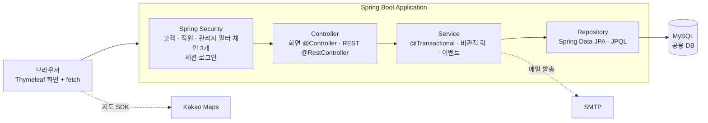
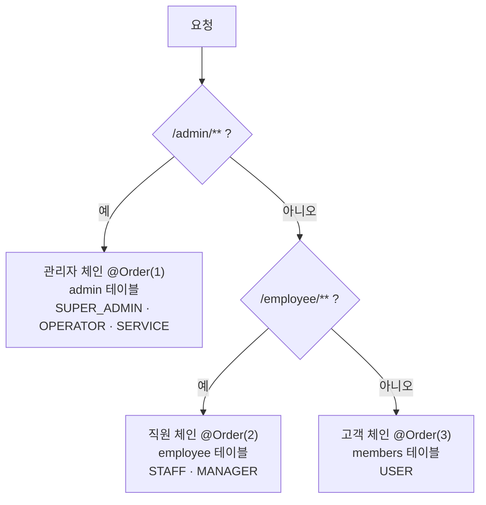
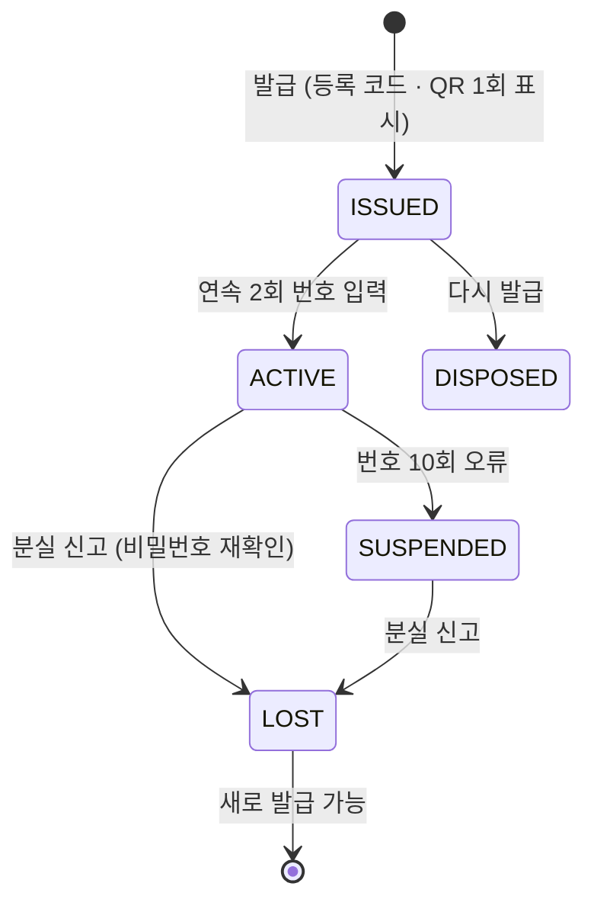
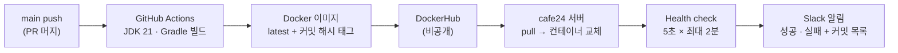

# ONBANK — Spring Boot 기반 모의 인터넷뱅킹

> 고객 · 직원 · 관리자가 함께 쓰는 **모의 인터넷뱅킹 서비스**입니다.
> 회원가입부터 계좌 개설, 이체, 예적금 · 대출, 직원 심사와 관리자 모니터링까지 은행의 업무 흐름을 구현했습니다.
>
> 이 문서는 **팀원1 신창만(PART 01 · 인증 · 보안)** 이 맡은 부분을 중심으로 정리했습니다.

| 항목 | 내용 |
|---|---|
| 개발 기간 | 2026. 10. 06 ~ 2026. 10. 23 (3주) |
| 팀 구성 | 4명 · 도메인별 1인 1파트 |
| 목표 | 기능 개수보다 **계좌 상태와 승인 절차 같은 은행 업무 로직** 구현 |
| 내 역할 | 회원가입 · 로그인 · Spring Security 권한, 비밀번호 보안, 이메일 인증, 가상 OTP, 지점 · ATM 찾기(카카오맵), Docker 자동 배포 |

---

## 목차

1. [팀 구성](#1-팀-구성)
2. [기술 스택](#2-기술-스택)
3. [시스템 구조](#3-시스템-구조)
4. [팀원1 담당 범위](#4-팀원1-담당-범위)
5. [시연 영상](#5-시연-영상)
6. [핵심 구현](#6-핵심-구현)
7. [트러블 슈팅](#7-트러블-슈팅)
8. [설계했지만 다음 단계로 남긴 것](#8-설계했지만-다음-단계로-남긴-것)
9. [실행 방법](#9-실행-방법)
10. [프로젝트 구조와 문서](#10-프로젝트-구조와-문서)
11. [회고](#11-회고)

---

## 1. 팀 구성

| 파트 | 이름 | 담당 |
|---|---|---|
| **PART 01** | **신창만** | **인증 · 보안** — 회원가입 · 로그인, Spring Security 권한, 가상 OTP, 지점 찾기, 자동 배포 |
| PART 02 | 오수빈 | 계좌 · 이체 · 자산관리 — 계좌 개설 · 입출금, 이체 · 동시성 제어, 예약 · 정기이체, 메인 디자인 |
| PART 03 | 이지훈 | 예적금 · 카드 · 대출 — 예적금 상품 가입 · 관리, 대출 신청 · 상환 스케줄 |
| PART 04 | 이시연 | 관리자 · FDS · 모니터링 — 관리자 · 직원 콘솔, 이상거래 탐지(FDS), 실시간 알림 |

**핵심 업무 흐름** — 네 파트가 하나의 흐름으로 이어집니다.

```
가입 · 로그인 → 계좌 개설 신청 → 본인확인 심사 → 입출금 · 이체 → 상품 · 대출 신청 → 심사 · 모니터링
   팀원1          팀원2            팀원1·4          팀원2           팀원3            팀원4
```

---

## 2. 기술 스택

| 구분 | 기술 |
|---|---|
| Backend | Java 21, Spring Boot 4.1.1, Spring MVC, **Spring Security 7**, Spring Data JPA, Gradle |
| Frontend | Thymeleaf (SSR), Thymeleaf Layout Dialect, HTML · CSS · JavaScript, fetch (REST API) |
| Database | MySQL (팀 공용 개발 DB), `ddl-auto=validate`, 파트별 SQL 스크립트로 스키마 관리 |
| 외부 API | **Kakao Maps JavaScript SDK**, SMTP(Gmail) 메일 발송 |
| 배포 | **Docker**, DockerHub(비공개), **GitHub Actions**, cafe24 서버, Slack 알림 |
| 협업 | Git · GitHub, Pull Request 리뷰 |

> 서버에서 화면을 그리는 Thymeleaf 구조에 맞춰 JWT 대신 **Spring Security 세션 기반 로그인**을 선택했습니다.

---

## 3. 시스템 구조



- 패키지는 도메인별로 나눴습니다: `member` · `employee` · `admin` · `account` · `savings` · `loan` · `otp` · `branch` …
- 테이블은 SQL 파일로 만들고, JPA는 `ddl-auto=validate`로 **엔티티와 테이블이 맞는지 검사만** 합니다. 공용 DB를 자동으로 바꾸지 않기 위해서입니다.

---

## 4. 팀원1 담당 범위

### 기능

| 구분 | 기능 | 상태 |
|---|---|---|
| 회원 | 회원가입(이메일 인증), 로그인 · 로그아웃, 비밀번호 찾기(임시 비밀번호 메일), 마이페이지(정보 수정 · 비밀번호 변경 · 탈퇴) | ✅ |
| 인증 · 권한 | 고객 · 직원 · 관리자 **로그인 3분리**(필터 체인 3개), 권한 계층, 세션 저장 분리 | ✅ |
| 로그인 보안 | 비밀번호 **5회 오류 잠금**, 임시 비밀번호 **변경 강제**, 같은 실패 문구, CSRF 보호 | ✅ |
| 가상 OTP | 발급 · 사용 등록(연속 2회) · 검증 · 분실 신고, 이체 2차 인증 연동 | ✅ |
| 지점 · ATM 찾기 | 카카오맵 지도 + 조건 검색(지점/ATM · 지역 · 이름 · 24시간 · 업무) | ✅ |
| 배포 | Docker 이미지 + GitHub Actions 자동 배포 + Slack 알림 | ✅ |
| 본인확인 심사, 이체한도 변경 신청, 고객 · 직원 로그인 이력 | 테이블 설계까지 | ⏳ [8장](#8-설계했지만-다음-단계로-남긴-것) |

### 담당 테이블 (9개)

`members` · `employee` · `otp_device` · `branch` · `branch_service` · `identity_verification` · `login_log` · `employee_login_log` · `transfer_limit_request`

정의: [docs/schema-team1-mysql.sql](docs/schema-team1-mysql.sql) · 데이터 사전: [docs/schema-team1-dictionary.md](docs/schema-team1-dictionary.md)

---

## 5. 시연 영상

| # | 영상 | 보여 주는 것 |
|---|---|---|
| 1 | [회원가입](<docs/temp1_시연영상/1.onbank_회원가입.mp4>) | 이메일 인증번호 발송 · 확인 후 가입 |
| 2 | [비밀번호 5회 오류 잠금](<docs/temp1_시연영상/2.onbank_회원비번5회틀리고잠김.mp4>) | 비밀번호를 5번 틀리면 계정 잠김 |
| 3 | [비밀번호 찾기](<docs/temp1_시연영상/3.onbank_비밀번호_찾기_이메일인증.mp4>) | 가입한 이메일로 임시 비밀번호 발송 → 로그인 → 비밀번호 변경 강제 |
| 4 | [고객 · 직원 · 관리자 로그인](<docs/temp1_시연영상/4.onbank_일반유저_직원_관리자로그인.mp4>) | 세 로그인 화면과 영역 분리 |
| 5 | [OTP 등록](<docs/temp1_시연영상/5.onbank_otp등록.mp4>) | OTP 발급 → 인증 앱 등록 → 연속 2회 입력으로 사용 등록 |
| 6 | [OTP를 사용한 계좌이체](<docs/temp1_시연영상/6.onbank_otp를 사용한계좌이체.mp4>) | 10만 원 초과 · 다른 회원 계좌 이체에서 OTP 입력 |
| 7 | [지점 찾기](<docs/temp1_시연영상/7.onbank_지점찾기.mp4>) | 카카오맵 지점 · ATM 검색과 정보창 |
| 8 | [자동 배포 테스트](<docs/temp1_시연영상/8.onbank_자동배포테스트.mp4>) | main 반영 → GitHub Actions → Docker 배포 → Slack 알림 |

---

## 6. 핵심 구현

### 6-1. 고객 · 직원 · 관리자 로그인 분리

로그인하는 사람이 세 종류라서, 하나의 로그인으로 처리하면 고객 계정으로 직원 화면에 들어가는 실수가 생길 수 있습니다. 그래서 **Spring Security 필터 체인을 세 개로 나눴습니다.**



| 항목 | 고객 | 직원 | 관리자 |
|---|---|---|---|
| 로그인 | `/login` | `/employee/login` (사번) | `/admin/login` |
| 테이블 | `members` | `employee` | `admin` |
| 권한 | `ROLE_USER` | `ROLE_STAFF`, `ROLE_MANAGER` | `ROLE_SUPER_ADMIN`, `ROLE_OPERATOR`, `ROLE_SERVICE` |
| 세션 저장 이름 | `SPRING_SECURITY_CONTEXT` | `…_EMPLOYEE` | `…_ADMIN` |

- **로그인 컨트롤러를 직접 만들지 않았습니다.** `POST /login`은 Spring Security 폼 로그인이 처리하고, 직접 만든 것은 "어느 테이블에서 회원을 찾을지"(`UserDetailsService`)와 "계정이 잠겼는지 · 정지됐는지"(`UserDetails`)입니다.
- **세션 저장 이름을 영역별로 나눴습니다.** 고객으로 로그인한 상태로 `/employee/**`에 가도 "로그인 안 함"으로 처리되고, 같은 브라우저에서 고객과 직원으로 함께 로그인해도 섞이지 않습니다.
- **권한 계층(`RoleHierarchy`)** 을 두었습니다. `MANAGER > STAFF`, `SUPER_ADMIN > OPERATOR · SERVICE`이고, OPERATOR와 SERVICE는 서로의 권한을 갖지 않습니다.
- 다른 팀원은 컨트롤러에서 `@AuthenticationPrincipal LoginMember me`로 로그인한 고객을 받아 씁니다. 회원 번호를 화면에서 받지 않아, 주소의 숫자를 바꿔 남의 정보를 보는 공격을 막습니다.

### 6-2. 로그인 보안

| 규칙 | 구현 |
|---|---|
| **비밀번호 5회 오류 잠금** | `LoginFailureHandler`가 실패 횟수를 올리고, 5회가 되면 잠금. 잠긴 계정은 비밀번호를 맞게 넣어도 로그인 불가 (세 영역 공통) |
| **같은 실패 문구** | 없는 아이디와 틀린 비밀번호를 같은 문구로 안내해 가입 여부를 알 수 없게 함 |
| **비밀번호 찾기** | 아이디 · 이름 · 생년월일 · 이메일이 모두 맞으면 가입한 이메일로 임시 비밀번호 발송. 잠금도 함께 해제 |
| **임시 비밀번호 변경 강제** | 임시 비밀번호로 로그인하면 변경 화면으로 보내고, 바꾸기 전에는 `TempPasswordFilter`가 다른 화면을 막음 |
| **비밀번호 저장** | BCrypt 해시 (`BCryptPasswordEncoder`) |
| **CSRF** | 끄지 않음. 폼은 `th:action`, fetch는 폼의 `_csrf` 값을 함께 보냄. 로그아웃은 POST만 허용 |

```
비밀번호 찾기 → 임시 비밀번호 메일 → 로그인 → 변경 화면으로 강제 이동
→ 새 비밀번호로 변경 → 자동 로그아웃 → 다시 로그인
```

### 6-3. 이메일 인증 (회원가입 · 마이페이지)

비밀번호 찾기 메일이 **가입한 이메일로** 가기 때문에, 가입할 때 실제로 받을 수 있는 주소인지 확인합니다.

| 항목 | 내용 |
|---|---|
| 인증번호 | `SecureRandom` 6자리, **5분** 유효, **60초** 후 재발송, 입력 **5회** 제한 |
| 저장 위치 | DB가 아니라 **세션** (짧게 쓰는 임시 값) |
| 비교 | `MessageDigest.isEqual` 고정 시간 비교 (응답 시간으로 번호를 추측하지 못하게) |
| 서버 재확인 | 화면에서 인증을 통과해도 **가입 요청 때 서버가 한 번 더 확인** |
| 메일 발송 | `EmailSender` 인터페이스 — 설정에 따라 SMTP 발송(`SmtpEmailSender`) 또는 콘솔 출력(`ConsoleEmailSender`) |

### 6-4. 가상 OTP (이체 2차 인증)

실물 OTP 기기 대신 **Google Authenticator 같은 OTP 앱**으로 쓸 수 있는 가상 OTP를 만들었습니다.



| 설계 | 이유 |
|---|---|
| **TOTP(RFC 6238) 직접 구현** | HMAC-SHA1과 잘라내기 몇 줄이라 외부 라이브러리 없이 구현. RFC 문서의 공식 테스트 값으로 검증 |
| **시드는 AES-256-GCM 암호화** | 서버가 시드로 번호를 다시 계산해야 해서 해시는 쓸 수 없음. 키는 DB · 코드가 아니라 설정에만 둠 |
| **등록 코드는 1번만 표시** | PRG + flash 속성. 새로고침해도 다시 볼 수 없음 |
| **연속 2회 입력으로 등록** | 실제로 기기를 갖고 있고 시계가 맞는지 확인 |
| **±30초 허용, 같은 번호 재사용 금지** | 기기 시계 오차는 받아 주고, 엿본 번호를 먼저 쓰는 것은 막음 |
| **오류 횟수는 별도 트랜잭션** (`REQUIRES_NEW`) | OTP를 틀려 이체가 롤백돼도 오류 횟수는 남아야 10회 정지가 동작함 |
| **잠금 조회** (`PESSIMISTIC_WRITE`) | 같은 번호로 동시에 두 번 통과하는 것을 막음 |

**이체 연동 (팀원2):** **10만 원 초과 + 다른 회원 계좌**로 보낼 때 팀원2의 이체 서비스가 `otpService.verify(memberId, code)`를 호출합니다. 계좌 비밀번호 확인과 OTP 검증은 계좌를 잠그기 **전에** 끝냅니다.

### 6-5. 지점 · ATM 찾기 (Kakao Maps API)

지점 데이터(이름 · 주소 · 위도 · 경도 · 영업시간 · 이용 가능 업무)는 **우리 DB와 REST API**가 주고, 카카오는 **지도를 그리는 일(Kakao Maps JavaScript SDK)** 만 맡습니다.

```
/branches (화면, 비회원 공개)
  → 서버가 설정의 JavaScript 키로 SDK를 불러옴 (키가 없으면 목록만 표시)
  → SDK 준비 후 kakao.maps.load()에서 지도 생성
  → fetch /api/branches?type=&keyword=&open24h=&service=  (JSON)
  → 지점마다 CustomOverlay 핀 표시 (지점 '지' · ATM 'A')
  → LatLngBounds로 결과 전체가 보이게 범위 조정
  → 핀 · 목록 클릭 시 정보창 + panTo 이동, 목록과 지도 선택 연동
```

- 목록 · 정보창의 글자는 `innerHTML`이 아니라 `textContent`로 넣어 XSS를 막았습니다.
- 서버는 지점과 이용 가능 업무를 **fetch join 한 번**으로 읽고, 사용 중인 지점만 보여 줍니다.
- 주소 → 좌표 변환 API는 쓰지 않고 좌표를 DB에 저장해, 외부 호출을 지도 그리기 하나로 줄였습니다.

### 6-6. Docker 자동 배포

main에 합치기만 하면 **빌드 → 이미지 → 서버 교체 → 확인 → 알림**까지 자동으로 진행됩니다.



| 항목 | 내용 |
|---|---|
| 이미지 | `eclipse-temurin:21-jre` + 빌드한 jar 하나, `TZ=Asia/Seoul`. `.dockerignore`로 jar 외에는 이미지에 들어가지 않음 |
| 태그 | `latest` + **커밋 해시 7자리** → 이전 커밋 이미지로 되돌릴 수 있음 |
| 실행 | `--restart unless-stopped` (재부팅 · 종료 시 자동 재시작), 포트 8000 |
| 비밀 설정 | DB 비밀번호 · OTP 키 등은 **이미지에 넣지 않음**. GitHub Secrets → 서버 파일 → 컨테이너에 **읽기 전용** 마운트 |

워크플로: [.github/workflows/docker-deploy.yml](.github/workflows/docker-deploy.yml) · Dockerfile: [project/onbank/Dockerfile](project/onbank/Dockerfile)

---

## 7. 트러블 슈팅

### ① OTP 오류 횟수가 쌓이지 않음 — 트랜잭션 롤백

| | 내용 |
|---|---|
| 문제 | 이체 중 OTP를 틀려도 오류 횟수가 늘지 않아 10회 정지가 동작하지 않을 수 있음 |
| 원인 | OTP 검증이 이체와 같은 트랜잭션이면, 이체가 롤백될 때 오류 횟수 증가도 함께 롤백됨 |
| 해결 | 검증을 별도 Bean(`OtpCodeChecker`)으로 분리하고 `@Transactional(propagation = REQUIRES_NEW)`로 따로 커밋. 같은 클래스 안에서 부르면 프록시를 거치지 않아 `REQUIRES_NEW`가 무시되므로 Bean을 나눔. 틀린 경우는 예외 대신 결과 값으로 돌려줘서 검증 트랜잭션 자체는 커밋되게 함 |
| 배운 점 | "같이 성공 · 실패해야 하는 것"과 "실패해도 남아야 하는 것"을 트랜잭션으로 구분해야 한다 |

### ② OTP 재발급 시 "회원당 1개" 제약 위반 — Hibernate 실행 순서

| | 내용 |
|---|---|
| 문제 | 사용 등록 전 OTP를 다시 발급하면 DB 유일 인덱스(회원당 사용 가능한 OTP 1개) 위반 |
| 원인 | 이전 기기 폐기(UPDATE)보다 새 기기 저장(INSERT)이 먼저 DB에 반영됨 (`IDENTITY` 방식은 저장 즉시 INSERT) |
| 해결 | 폐기 직후 `flush()`로 UPDATE를 먼저 DB에 보냄 |
| 배운 점 | JPA의 변경 반영 시점과 순서를 알아야 DB 제약과 충돌하지 않는다 |

### ③ 자동 배포 첫 실행 실패 — SSH 호스트 키

| | 내용 |
|---|---|
| 문제 | GitHub Actions에서 서버 접속 단계 실패 |
| 원인 | 호스트 키 등록(`ssh-keyscan`)에서 키 종류를 지정했는데 cafe24 서버의 키 종류와 맞지 않음 |
| 해결 | 키 종류 지정을 빼고 서버가 가진 키를 모두 받도록 변경 |
| 배운 점 | 실패도 Slack으로 바로 알림이 와서 원인을 빨리 찾을 수 있었다 |

---

## 8. 설계했지만 다음 단계로 남긴 것

| 기능 | 현재 상태 |
|---|---|
| 본인확인 심사 (첫 계좌 개설 시 신청 → 직원 승인 · 반려) | `identity_verification` 테이블 설계 |
| 이체한도 변경 신청 (감액 즉시 · 증액은 책임자 심사) | `transfer_limit_request` 테이블 설계 |
| 고객 · 직원 로그인 이력 | `login_log`, `employee_login_log` 테이블 설계 (관리자 로그인 이력만 기록 중) |
| 자동 로그아웃 시간 · 중복 로그인 제한 | 미적용 (세션 기본값 사용) |
| 위치 기반 가까운 지점 찾기 | 지금은 지역 · 이름 · 업무 조건 검색 |
| HTTPS · 무중단 배포 · 세션 공유(Redis) | 배포 서버는 HTTP · 컨테이너 교체 방식 |

---

## 9. 실행 방법

**필요한 것:** JDK 21, MySQL 8.0.16 이상

```bash
# 1. 테이블 · 시드 데이터 (팀원1 부분 예시)
mysql -u <계정> -p onbank < docs/schema-team1-mysql.sql
mysql -u <계정> -p onbank < docs/data-team1-mysql.sql

# 2. 설정 파일 만들기 (Git에 올라가지 않음)
cd project/onbank/src/main/resources
cp application-local.properties.example application-local.properties
#   DB 접속 정보, OTP 시드 암호화 키, 카카오맵 JavaScript 키, (선택) SMTP 설정 입력

# 3. 실행
cd project/onbank
./gradlew bootRun --args='--server.port=8080'
# → http://localhost:8080
```

| 설정 | 설명 |
|---|---|
| `onbank.otp.seed-key` | 32바이트 무작위 값의 Base64(44글자). 예: `openssl rand -base64 32`. **공용 DB를 쓰면 팀원 모두 같은 키** |
| `onbank.kakao.js-key` | 카카오 개발자 콘솔에서 발급. 없으면 지도 없이 목록만 표시 |
| `onbank.mail.enabled` | `true`면 SMTP 발송, 기본값 `false`면 메일 내용을 콘솔에 출력 |

**시드 계정 (개발용)**

| 구분 | 아이디 | 비밀번호 |
|---|---|---|
| 고객 (`/login`) | `user1` (본인확인 완료) · `user2` · `user3` | `user1234!` |
| 직원 (`/employee/login`) | `E0001` · `E0002` (MANAGER) · `E0003` (STAFF) | `staff1234!` |

관리자 계정(`/admin/login`)은 팀원4의 시드(`docs/data-admin-mysql.sql`)에 있습니다.

---

## 10. 프로젝트 구조와 문서

```
project/onbank/src/main/java/org/doit/onbank/
├─ config/SecurityConfig.java     필터 체인 3개 · 권한 계층 · 접근 규칙
├─ common/security/               로그인 성공·실패 핸들러, 임시 비밀번호 필터
├─ common/mail/                   EmailSender (SMTP / 콘솔)
├─ member/                        회원가입 · 이메일·휴대폰 인증 · 비밀번호 찾기 · 마이페이지
├─ employee/security/, admin/security/   직원 · 관리자 로그인
├─ otp/                           가상 OTP (TOTP · AES-GCM · 발급 · 검증)
└─ branch/                        지점 · ATM 찾기 (REST API)
```

| 문서 | 내용 |
|---|---|
| [docs/README.md](docs/README.md) | 전체 기획서 (요구사항 · 메뉴 · 권한표 · 테이블) |
| [docs/auth.md](docs/auth.md) | 인증 · 보안 · OTP 설계 가이드 |
| [docs/schema-team1-mysql.sql](docs/schema-team1-mysql.sql) | 팀원1 테이블 DDL |
| [docs/data-team1-mysql.sql](docs/data-team1-mysql.sql) | 팀원1 시드 데이터 |

---

## 11. 회고

> 인증 · 보안의 개념과 구현을 배웠고, 표준(TOTP)만 맞추면 실제 OTP 앱과 연동된다는 것도 알게 되었습니다.
> 카카오맵 API 활용과 Docker 배포도 재미있었습니다.
>
> — 신창만 (PART 01 · 인증 · 보안)
